<!--
  Every graphic on this page is an SVG drawn by scripts/build.py and published
  to the `output` branch by .github/workflows/profile.yml, once a day.
-->

<picture>
  <source media="(prefers-color-scheme: dark)" srcset="https://raw.githubusercontent.com/Pooria82/Pooria82/output/header-dark.svg">
  
</picture>

 

  <a href="https://linkedin.com/in/pooria-madani-sani-5158b3280"><picture><source media="(prefers-color-scheme: dark)" srcset="https://raw.githubusercontent.com/Pooria82/Pooria82/output/social-linkedin-dark.svg"></picture></a>&nbsp;
  <a href="https://x.com/MadaniPooria"><picture><source media="(prefers-color-scheme: dark)" srcset="https://raw.githubusercontent.com/Pooria82/Pooria82/output/social-x-dark.svg"></picture></a>&nbsp;
  <a href="https://instagram.com/pm82.official"><picture><source media="(prefers-color-scheme: dark)" srcset="https://raw.githubusercontent.com/Pooria82/Pooria82/output/social-instagram-dark.svg"></picture></a>

 

<h3><picture><source media="(prefers-color-scheme: dark)" srcset="https://raw.githubusercontent.com/Pooria82/Pooria82/output/title-about-dark.svg"></picture></h3>

I'm a QA engineer at MediQo and a computer engineering student at Ferdowsi University of Mashhad. I build backends and full-stack apps, break them on purpose with automated tests, and ship AI tools that run on your own machine.

- **Now** building [ParsRAG](https://github.com/Pooria82/ParsRAG): offline chat with Persian and English documents, every answer cited
- **At MediQo** automating API tests: functional, contract, security, tenancy and performance
- **Stack** Python, TypeScript and Go on the backend, React on the front, pytest, Playwright and Locust for QA
- **Teaching** programming. Ask me about Python, C++, Java or backend architecture
- **Open to** collaborating on backend, full-stack, QA and AI projects

 

<h3><picture><source media="(prefers-color-scheme: dark)" srcset="https://raw.githubusercontent.com/Pooria82/Pooria82/output/title-work-dark.svg"></picture></h3>

<a href="https://github.com/Pooria82/ParsRAG"><picture><source media="(prefers-color-scheme: dark)" srcset="https://raw.githubusercontent.com/Pooria82/Pooria82/output/card-parsrag-dark.svg"></picture></a>

<a href="https://github.com/Pooria82/ParsRAG"><b>Repository</b></a> &nbsp;·&nbsp; <a href="https://pooria82.github.io/ParsRAG-Landing/"><b>Landing page</b></a>

  <a href="https://github.com/Pooria82/DistributedAuthSecurityAnalysis"><picture><source media="(prefers-color-scheme: dark)" srcset="https://raw.githubusercontent.com/Pooria82/Pooria82/output/card-distributedauthsecurityanalysis-dark.svg"></picture></a>
  <a href="https://github.com/Pooria82/linkedin-talent-discovery"><picture><source media="(prefers-color-scheme: dark)" srcset="https://raw.githubusercontent.com/Pooria82/Pooria82/output/card-linkedin-talent-discovery-dark.svg"></picture></a>
  <a href="https://github.com/Pooria82/HPC-Parallel-Algorithms"><picture><source media="(prefers-color-scheme: dark)" srcset="https://raw.githubusercontent.com/Pooria82/Pooria82/output/card-hpc-parallel-algorithms-dark.svg"></picture></a>
  <a href="https://github.com/Pooria82/beer-distribution-game"><picture><source media="(prefers-color-scheme: dark)" srcset="https://raw.githubusercontent.com/Pooria82/Pooria82/output/card-beer-distribution-game-dark.svg"></picture></a>

<b>More projects</b>: security, systems, AI bots, web and games

 

| Area | Project | What it is |
| :-- | :-- | :-- |
| Security | [mini-fail2ban](https://github.com/Pooria82/mini-fail2ban) | Async host-based intrusion prevention that blocks SSH brute force in real time |
| Security | [SecureRESTAPI-KMS](https://github.com/Pooria82/SecureRESTAPI-KMS) | FastAPI and MongoDB service with HashiCorp Vault key rotation, JWT and 2FA |
| Security | [secure-question-renderer](https://github.com/Pooria82/secure-question-renderer) | Laravel service that turns question banks into anti-OCR protected PDF exams |
| Security | [Secure-File-Transfer-System](https://github.com/Pooria82/Secure-File-Transfer-System) | Client-server file transfer with integrity and confidentiality checks |
| Systems | [Dynamic-Multi-Processor-Scheduling-System](https://github.com/Pooria82/Dynamic-Multi-Processor-Scheduling-System) | Deadline-aware scheduling strategies for multi-processor environments |
| Systems | [TCP-CUBIC-congestion-control-mechanism](https://github.com/Pooria82/TCP-CUBIC-congestion-control-mechanism) | A TCP CUBIC congestion control implementation |
| Systems | [File-Monitoring-rdfind-simulator](https://github.com/Pooria82/File-Monitoring-rdfind-simulator) | Multi-threaded duplicate-file finder in C, in the spirit of rdfind |
| Systems | [Tic-Tac-Net](https://github.com/Pooria82/Tic-Tac-Net) | Peer-to-peer tic-tac-toe with a central server for users and data |
| AI & data | [telegram-sora-video-bot](https://github.com/Pooria82/telegram-sora-video-bot) | Telegram bot for AI video with Persian prompt translation and safety filters |
| AI & data | [Movies-Data-Analysis](https://github.com/Pooria82/Movies-Data-Analysis) | What drives a film's ratings, popularity and revenue |
| Web | [Chat-Service](https://github.com/Pooria82/Chat-Service) | Real-time group and private chat with FastAPI, MongoDB and Socket.IO |
| Web | [ParsRAG-Landing](https://github.com/Pooria82/ParsRAG-Landing) | Bilingual landing page for ParsRAG with Three.js and GSAP |
| Games | [Block-Breaker](https://github.com/Pooria82/Block-Breaker) · [Capture-Countries](https://github.com/Pooria82/Capture-Countries) · [Battleship](https://github.com/Pooria82/Battleship) · [Minesweeper](https://github.com/Pooria82/Minesweeper) | Games in C, Java and C++ |

 

<h3><picture><source media="(prefers-color-scheme: dark)" srcset="https://raw.githubusercontent.com/Pooria82/Pooria82/output/title-toolbox-dark.svg"></picture></h3>

<picture>
  <source media="(prefers-color-scheme: dark)" srcset="https://raw.githubusercontent.com/Pooria82/Pooria82/output/toolbox-dark.svg">
  
</picture>

  

<h3><picture><source media="(prefers-color-scheme: dark)" srcset="https://raw.githubusercontent.com/Pooria82/Pooria82/output/title-glance-dark.svg"></picture></h3>

<picture>
  <source media="(prefers-color-scheme: dark)" srcset="https://raw.githubusercontent.com/Pooria82/Pooria82/output/glance-dark.svg">
  
</picture>

  

<picture>
  <source media="(prefers-color-scheme: dark)" srcset="https://raw.githubusercontent.com/Pooria82/Pooria82/output/footer-dark.svg">
  
</picture>

Every graphic on this page is a hand-built SVG, regenerated daily by <a href="scripts/build.py">scripts/build.py</a>.

